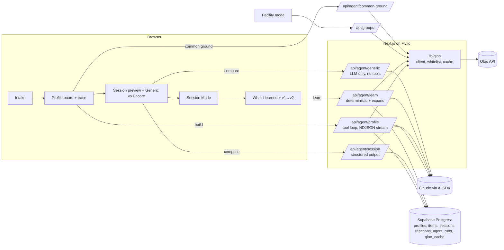

# Encore

**When someone can no longer tell you what they love, their taste graph still can.**

Encore is a taste-memory agent for dementia caregivers. A caregiver shares a first name, a birth year, a hometown and two to five things their person loved. Encore uses [Qloo](https://qloo.com)'s cross-domain taste graph to rebuild that person's cultural world from their formative years (music, film, TV, books, places, food), turns it into short daily sessions a caregiver plays on a tablet, and learns from how the person reacts.

> Encore is a comfort and connection tool, not a medical device or treatment.

Built for the Qloo Agentic Hackathon. MIT licensed.

## What it does

1. **Intake (2 minutes).** First name, birth year, hometown, a few loves, and anything to avoid. Each love is resolved against Qloo `/search`; when a name is ambiguous ("The Magnificent Seven": 1960 or the 2016 remake?) the caregiver picks from the top candidates. Encore pre-selects the era-appropriate one but never guesses silently.
2. **Profile build (an agent, streamed).** Encore computes the person's reminiscence window (ages 10 to 30) and runs a tool-calling loop over Qloo: `/v2/insights` per domain with the seeds as signals, era filters, the hometown as location, the 55+ age signal, and exclusions for the avoid list and default unsafe content. You watch every call and the agent's reasoning as it happens. The agent picks a diverse shortlist, and every pick carries Qloo explainability ("Because Dorothy loved Frank Sinatra 0.27").
3. **Sessions.** The agent composes a 15-20 minute arc (warm opener, variety, calm closer) of 6-8 items with caregiver prompts written to clinical rules: recognition, not recall. Never "Do you remember…?".
4. **Session Mode.** One calm item at a time on a tablet: big poster or cover, big type, one play button. The caregiver taps how the person reacted: *Lit up*, *Sang or talked along*, *Neutral*, *Upset*. Upset stops the item immediately and offers a favourite instead.
5. **Their years, as a picture.** The profile places the films, shows and books Encore found at their years inside the ages 10-30 band, with the singers of those years alongside.
6. **In their own language.** If the person's first language isn't English, every caregiver prompt is also written in it (Roberto's sessions are in Spanish too), checked by the same never-test-memory rule, with a toggle in Session Mode.
7. **Learning.** Reactions are applied deterministically (`sang_along +2`, `lit_up +1`, `upset` → excluded forever plus its strongest genre tag). Liked items are promoted into the Qloo signal and the agent expands the profile to v2, showing exactly what changed and why.

### Also built

- **Engagement report** (from any profile). What works for this person: warm-reaction share by kind, best moments, Qloo genres that land or don't, what's kept out, and a printable activity log for families and care teams. The example personas include two practice sessions (real composer, learning and expansion; simulated taps, labelled as such) so the report isn't empty on first look.

- **Facility mode** (`/facility`). An activities director picks 2-5 residents. Encore pools their seeds into one Qloo query per domain and puts first the picks whose top explainability drivers belong to the most residents ("Connects Dorothy, Roberto, Margaret"), then composes a group session that addresses the whole room.
- **Common Ground** (on any profile). A caregiver adds up to three of their own favourites. Qloo Analysis Compare (`/v2/insights/compare`) finds the taste they share, and insights seeded with both people surface things to enjoy together, each attributed to both sides ("From Dorothy's Roman Holiday and your Norah Jones").

### For judges

- **Generic AI vs Encore.** On any session, "Compare with a generic AI" asks the same model, with the same intake and no tools, for a session, then computes the differences: memory-test questions, new finds versus repeats of the seeds, traceability, era match, and real playable media.
- **How Encore thought.** Every profile has a timeline of every Qloo call with its exact parameters, result counts and latency.
- **Provenance chips** on every item come straight from `query.explainability`.

## Why this needs Qloo

A language model alone produces the famous hits of a decade, repeats what you told it, and cannot show its sources. Encore builds outward from *this person's* seeds, scoped to *their* years and *their* hometown, and every item is traceable to a seed with a score. The learning loop works because Qloo takes entity IDs as signals: promoting a song the person sang along to literally changes the next query.

Qloo endpoints and parameter families used:

| Endpoint | Used for | Parameters |
|---|---|---|
| `GET /search` | Seed resolution, hometown lookup | `query`, `types` (artist, movie, tv_show, book, place, destination, locality) |
| `GET /v2/insights` | Every recommendation | `filter.type`, `signal.interests.entities`, `signal.demographics.age`, `filter.release_year.min/max`, `filter.publication_year.min/max`, `filter.release_country`, `filter.location` (locality ID or WKT), `filter.location.radius`, `filter.tags`, `filter.exclude.tags`, `filter.exclude.entities`, `filter.popularity.max`, `feature.explainability`, `take` |
| `GET /v2/tags` | Avoid list and cuisines to tag IDs | `filter.query`, `filter.parents.types`, `feature.typo_tolerance` |
| `GET /entities` | Seed details (images, Spotify/IMDb IDs, notable songs) | `entity_ids` |
| `GET /v2/insights/compare` | Common Ground between caregiver and loved one | `a.signal.interests.entities`, `b.signal.interests.entities` |

Things we learned by probing (details in [CLAUDE.md](CLAUDE.md)): parameters a type doesn't support are silently ignored, so `lib/qloo/params.ts` validates every request against a per-type whitelist; books need `filter.publication_year`, not `release_year`; `filter.release_country` needs full country names; location radius is in meters; artists have no era filter, so Encore post-filters on their career start year.

## Architecture



- **Agent loop:** Vercel AI SDK 7 `streamText` with tools (`qloo_insights`, `qloo_tags_search`, `save_profile`), `stopWhen: [isStepCount(12), hasToolCall("save_profile")]`. The provider is swappable in `lib/agent/llm.ts`; the model comes from `LLM_MODEL`.
- **Guardrails:** era, country, location, age and exclusions are filled in server-side; the model can only override. Any entity ID the model didn't receive from Qloo in this run is dropped. Session prompts that test memory are replaced. A deterministic fallback exists for every LLM step. Agent endpoints are rate-limited per workspace and IP.
- **No login:** an anonymous workspace cookie. Example personas are read-only templates; opening one copies it into your workspace so visitors never see each other's reactions.
- **Caching:** Qloo responses are cached privately in Postgres by request hash. No Qloo data is committed to this repo: persona templates are built by a script against the live API, and test fixtures are synthetic.
- **Media:** Spotify artist embeds; YouTube and TMDB when keys are configured (otherwise YouTube search links); Google Maps links for places. Nothing is hosted by us.

## Run it locally

Requirements: Node 22+, a Supabase project, a Qloo hackathon key, an Anthropic key.

```bash
cp .env.example .env.local      # fill in the keys below
npm install
npm run migrate                 # needs SUPABASE_ACCESS_TOKEN (a Supabase personal access token)
npm run seed:personas           # builds the Dorothy, Roberto and Margaret templates with the live agent
npm run dev                     # http://localhost:3000
npm test                        # unit tests: param whitelist, era math, learning, session guardrails, group attribution, client
```

| Variable | Required | Notes |
|---|---|---|
| `QLOO_API_KEY` | yes | Server-side only |
| `QLOO_BASE_URL` | yes | `https://hackathon.api.qloo.com` |
| `ANTHROPIC_API_KEY` | yes | |
| `LLM_MODEL` | yes | e.g. `claude-sonnet-5-5` |
| `SUPABASE_URL`, `SUPABASE_SERVICE_ROLE_KEY` | yes | Service role, server-side only; RLS blocks every other key |
| `SUPABASE_ACCESS_TOKEN` | for migrations | Personal access token for the Management API |
| `TMDB_API_KEY`, `YOUTUBE_API_KEY` | optional | Posters, trailers and exact songs |

### Deploy (Fly.io)

```bash
fly launch --no-deploy --copy-config      # uses fly.toml (region syd, next to Supabase)
fly secrets set QLOO_API_KEY=... ANTHROPIC_API_KEY=... SUPABASE_URL=... SUPABASE_SERVICE_ROLE_KEY=...
fly deploy
```

## The evidence, honestly

- Long-term musical memory relies on brain regions that show relatively less atrophy and metabolic decline in Alzheimer's disease (Jacobsen et al., *Brain* 2015;138(8):2438-2450).
- The 2025 Cochrane review of music-based therapy in dementia found it probably improves depressive symptoms slightly (moderate certainty) and may improve social behaviour, but probably does not reduce agitation. Encore is therefore positioned as a connection and mood tool, not a treatment.
- The WHO reports more than 55 million people living with dementia (2021), projected to reach 78 million by 2030.

**Privacy:** first name and birth year only. No diagnoses, no medications, no photos of real people. Illustrations were generated for this project.

## License

[MIT](LICENSE)
